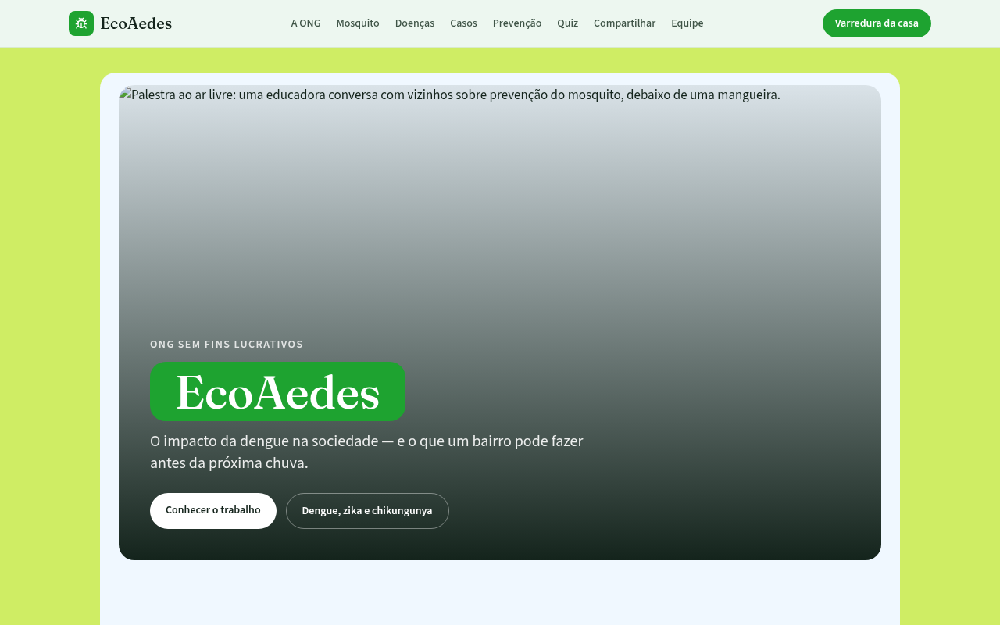
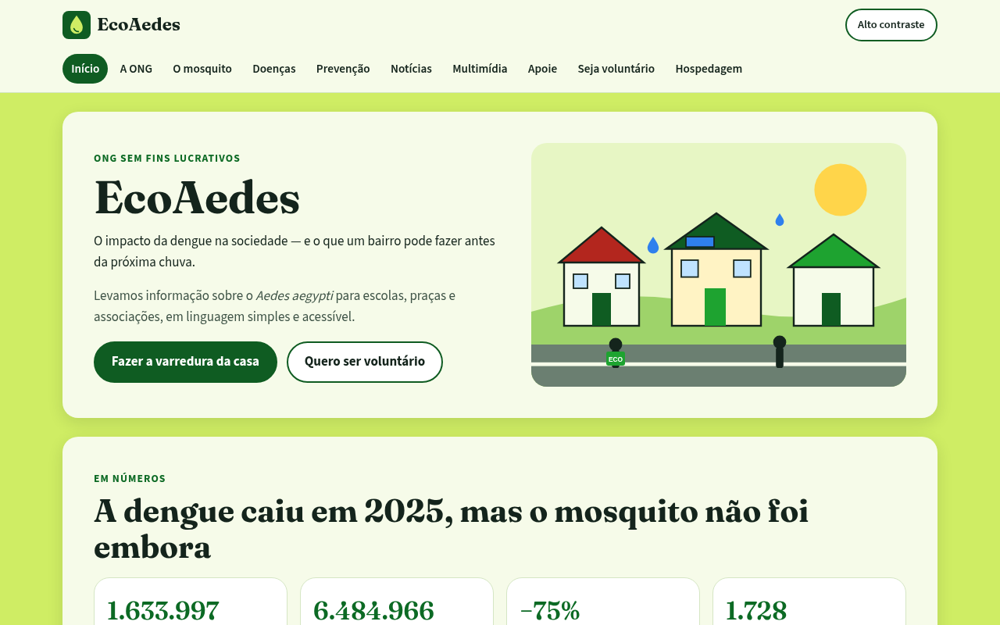
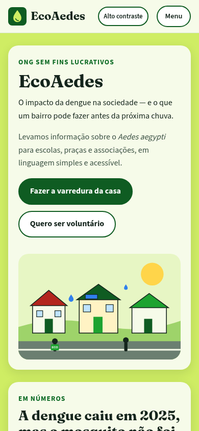

# Melhorias em relação ao MVP (1ª entrega)

## Antes (MVP em React)

## Depois (HTML5 + CSS3 + JavaScript puro)

Outras telas: [alto contraste](prints/home_alto_contraste.png), [menu aberto no celular](prints/home_mobile_menu_aberto.png), [erros do formulário](prints/voluntario_erros.png), [envio com sucesso](prints/voluntario_sucesso.png).

## O que mudou

| Item | Antes (MVP) | Depois |
|---|---|---|
| Tecnologia | React 19 + Vite + Tailwind (precisa de build) | HTML5, CSS3 e JS puro (abre direto no navegador) |
| Páginas | 1 página (SPA) | 10 páginas interligadas |
| Validação W3C | 57 erros no DOM gerado | 0 erros em todas as páginas |
| Formulário | Não existia | Formulário de voluntário com validação, rascunho e mensagem de sucesso |
| localStorage | Só no checklist | Checklist, rascunho do formulário e alto contraste |
| Imagens | Arquivos `/images/*.jpg` faltando (quebradas) | SVGs originais, todas com `alt` |
| Multimídia | Nenhuma | Vídeo do YouTube, áudio com transcrição, vídeo com legenda |
| Doações / notícias | Não existiam | Página Apoie (Pix de exemplo) e Notícias com filtro |
| Acessibilidade | Parcial | Alto contraste, menu com `aria-expanded`, link "Ir para o conteúdo", foco visível, movimento reduzido |
| Publicação | GitHub Pages desativado (404) | Pronto para o GitHub Pages sem build (falta ativar) |
| Documentação | Sem pasta `docs/` | Escopo, diário, testes, IA, orçamento, créditos |
